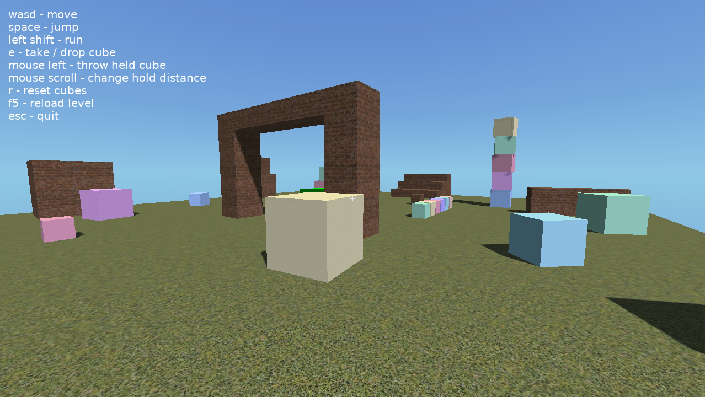

### Dependencies
* C++17 compiler
* SDL2
* SDL2_image
* Bullet Physics
* GLEW
* OpenGL and GLU
* FreeType 2
* pkg-config
### Build
```
g++ main.cpp -o engine.exe -O2 -std=c++17 -lmingw32 -lSDL2main -lSDL2 -lSDL2_image -lBulletDynamics -lBulletCollision -lLinearMath -lglew32 -lopengl32 -lglu32 $(pkg-config --cflags --libs freetype2)
```

### Build (Windows)
1. Install [MSYS64](https://www.msys2.org/)
2. Install dependencies:
   ```
   pacman -S --needed \
   mingw-w64-ucrt-x86_64-toolchain \
   mingw-w64-ucrt-x86_64-SDL2 \
   mingw-w64-ucrt-x86_64-SDL2_image \
   mingw-w64-ucrt-x86_64-bullet \
   mingw-w64-ucrt-x86_64-glew \
   mingw-w64-ucrt-x86_64-freetype \
   mingw-w64-ucrt-x86_64-pkgconf
   ```
3. Use build script (build.bat):
      ```
      set "PATH=C:\msys64\ucrt64\bin;%PATH%"

      for /f "delims=" %%i in ('pkg-config --cflags --libs freetype2') do set "FREETYPE_FLAGS=%%i"
      
      g++ main.cpp -o engine.exe ^
        -IC:/msys64/ucrt64/include/bullet ^
        -O2 -std=c++17 ^
        -lmingw32 -lSDL2main -lSDL2 -lSDL2_image ^
        -lBulletDynamics -lBulletCollision -lLinearMath ^
        -lglew32 -lopengl32 -lglu32 ^
        %FREETYPE_FLAGS%

      engine.exe
      ```

### Run
```
engine.exe                    # loads levels/level1.txt
engine.exe levels/level2.txt  # any level, path relative to the exe folder
```
Levels are read from `<exe folder>/levels/`, textures from `<exe folder>/textures/`.

### Controls
- WASD - move, Space - jump, Left Shift - run
- E - take / drop cube, Left Mouse - throw held cube, Mouse Wheel - hold distance
- R - reset cubes
- F5 - reload the current level from disk (edit the level file, press F5, no restart needed)
- Esc - quit

### Levels
A level is a plain text file. `#` starts a comment, blank lines are ignored, and the order of commands does not matter (objects are created after the whole file is read). Units are meters and degrees.
 
| Command | Meaning |
|---|---|
| `respawn <y>` | boxes that fall below this height return to their start position |
| `spawn <x> <y> <z> [angle]` | player start (`y` is the feet level, `angle` is yaw in degrees) |
| `material <id> <texture> <r> <g> <b> [tiling] [offset] [options]` | define a material for this level |
| `materialpersist ...` | same, but the material survives level reloads and level changes |
| `static <pos> <rot> <size> [material]` | immovable block: floor, wall, building |
| `box <pos> <rot> <size> [material]` | dynamic box: can be picked up, thrown, pushed |

`<pos>` is the center `x y z`, `<rot>` is `pitch yaw roll` in degrees, `<size>` is the full size `x y z`. A box weighs `volume * BOX_DENSITY`.

#### Materials
```
material <id> <texture> <r> <g> <b> [tiling] [offset] [key=value ...]
```
* `<texture>` - file name inside `textures/`, or `-` for no texture (plain color).
* `<r> <g> <b>` - 0..255 color multiplier on top of the texture (`255 255 255` = unchanged).
* `tiling`, `offset` - `x;y` pairs, or a single number for both axes (`1;1`, `0.5`). On `static` objects UV is measured in meters: tiling `1` = one texture per meter. On `box` objects the whole texture is stretched over every face.
* Optional `key=value` parameters, in any order after tiling/offset:

| Key | Meaning | Default |
|---|---|---|
| `normalmap=<file>` | normal map (file in `textures/`, `-` = none) | none |
| `metalmap=<file>` | metallic map, the red channel is used | none |
| `metallic=<0..1>` | metallic multiplier (the plain value if there is no map) | `0` |
| `roughness=<0..1>` | 0 = mirror, 1 = matte | `0.8` |
| `normalstrength=<n>` | 1 = as in the texture, 0 = flat | `1` |
| `normalflipy=<0\|1>` | `1` for DirectX-style normal maps (inverted green channel) | `0` |

Examples:
```
material grass grass.png 255 255 255 0.5;0.5 0;0
material pink  - 255 179 186 1;1 0;0
material plate plate.png 255 255 255 1;1 0;0 normalmap=plate_n.png metalmap=plate_m.png metallic=1 roughness=0.35
material steel - 200 205 215 1;1 0;0 metallic=1 roughness=0.3
```
If a normal map looks inverted (dents instead of bumps), set `normalflipy=1` on that material.

Objects without a material are drawn with `DEFAULT_OBJECT_COLOR` from `consts.h`.

### Rendering
* **Cascaded shadow maps** - 4 cascades computed from the camera. The first cascade is the sharpest, the last is the coarsest and fades out. Sizes, distances, bias and fade are in `consts.h` (`SHADOW_*`). The shader is built for exactly 4 cascades.
* **Lighting** - ambient + one sun with a normal-mapped diffuse term, a Blinn-Phong highlight and an analytic sky reflection (the same gradient the sky dome uses). No tangents are stored in the geometry: the tangent frame is rebuilt in the fragment shader.
* **Texture units** - 0: HUD, 1: albedo, 2..5: shadow cascades, 6: normal map, 7: metallic map.

### Structure
| File | Purpose |
|---|---|
| `main.cpp` | window, GL context, main loop |
| `consts.h` | every tunable number: physics, player, camera, sky, shadows, HUD, box presets |
| `vec3.h` | `Vec3` and math constants |
| `paths.h` | location of the exe folder (base for `levels/` and `textures/`) |
| `world.h` | Bullet world, static blocks and boxes, respawn, rendering of the scene |
| `level.h` | level file loader (`levels/*.txt`) |
| `materials.h` | material registry and binding of material parameters to the shader |
| `textures.h` | texture loading and caching via SDL2_image |
| `controller.h` | player body, camera, movement, pick up / throw |
| `sky.h` | sky dome and sun disc |
| `shadows.h` | cascaded shadow maps (FBOs) and the lighting/shadow shader |
| `geometry.h` | shared unit cube |
| `hud.h`, `font.h` | FreeType text rendering and the embedded font |